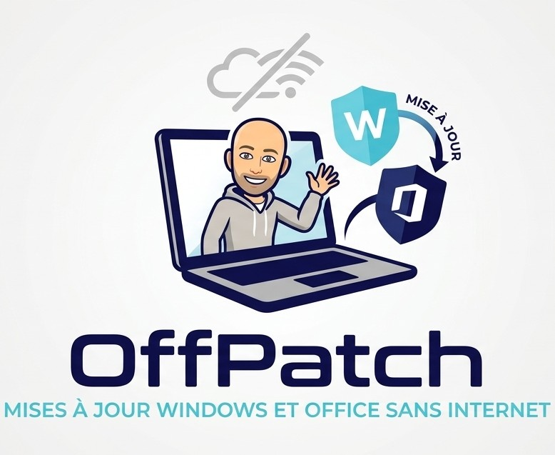

# OffPatch

<p align="center"></p>

Outil Windows portable qui prépare une fois par mois un dépôt de mises à jour Microsoft, puis les installe **sans connexion Internet** sur des PC traités un par un : en atelier, ou chez un client. Il prend la suite de WSUS Offline Update, qui n'est plus maintenu.

> **État du projet : version 1.0.0** (voir le [journal des versions](CHANGELOG.md)). Toutes les fonctions sont là : mise à jour du dépôt, préparation d'une clé, installation manuelle ou automatique avec reprise après redémarrage, rapport. Elles ont été validées sur des runners GitHub et sur des machines virtuelles Windows 10 et Windows 11. Trois cas restent à voir sur de vrais PC clients : un Windows 10 inscrit à l'ESU, un PC ARM64 avec Office, et la mise à jour d'un Office Click-to-Run installé (voir la matrice des tests dans le [cahier des charges](docs/CAHIER-DES-CHARGES.md), section 12).

## Ce que fait OffPatch

**Côté dépôt** (PC connecté, une fois par mois), il télécharge et vérifie :

- les cumulatives Windows 11 (24H2, 25H2, 26H2, x64 et ARM64) et Windows 10 22H2 (x64, ESU), avec leurs prérequis (cumulatives « checkpoint », SSU) ;
- l'enablement package Windows 11 26H2 ;
- les cumulatives .NET Framework ;
- la plateforme et les définitions Microsoft Defender ;
- une source Office par canal (Current, Office LTSC 2024, Office LTSC 2021), par l'Office Deployment Tool, pour mettre à jour l'Office Click-to-Run déjà installé sur le PC.

Chaque fichier est contrôlé au téléchargement (signature Authenticode Microsoft, SHA-256) puis rangé dans un dépôt sans doublons, décrit par un manifeste.

**Côté client** (PC hors ligne, depuis une clé USB ou un disque), il relève ce qui manque et établit un plan avec les redémarrages nécessaires. Il revérifie chaque fichier juste avant de s'en servir, installe, puis écrit un rapport d'intervention HTML. Deux façons de faire :

- en mode manuel, on coche les étapes à installer ;
- en mode automatique, un écran récapitulatif montre tout ce qui va être fait. On valide une fois et OffPatch enchaîne les étapes et les redémarrages. Après chaque redémarrage, il reprend seul à l'ouverture de session, même si la clé a changé de lettre.

## Mise en place

Une seule fois, sur le PC qui gardera le dépôt (il lui faut Internet et une trentaine de Go libres pour un dépôt complet) :

1. Télécharger l'archive de la dernière version dans la page Releases du dépôt GitHub (ou l'archive zip du code).
2. **Avant de l'extraire** : clic droit sur le fichier zip, Propriétés, cocher « Débloquer », OK. Sinon Windows marque chaque fichier comme venant d'Internet et affiche un avertissement au lancement, avant même qu'OffPatch puisse retirer cette marque.
3. Extraire l'archive où l'on veut, par exemple `D:\OffPatch`. Le dossier peut être déplacé ensuite : OffPatch retrouve sa racine grâce au fichier `offpatch.root`.
4. Lancer `Lancer-OffPatch.cmd` et accepter la demande d'élévation.
5. Onglet **Dépôt** : cocher les versions de Windows et les sources Office utiles, puis « Enregistrer la sélection ». Moins on en coche, plus le dépôt est petit. Chaque source Office ne sert qu'aux PC dont l'Office est sur ce canal.
6. « Mettre à jour le dépôt ». Le premier passage télécharge tout (environ 20 Go pour un dépôt complet) ; les suivants ne prennent que les nouveautés. L'Office Deployment Tool est récupéré au passage.

Rien d'autre à installer : Windows PowerShell 5.1, présent sur tout Windows 10 et 11, suffit, sur le PC du dépôt comme sur les PC clients.

## Routine mensuelle

Sur le PC du dépôt, après le Patch Tuesday (deuxième mardi du mois) :

1. Onglet Dépôt, « Vérifier les nouveautés », puis « Mettre à jour le dépôt ». Le résumé liste ce qui est arrivé.
2. « Purger » retire les fichiers qui ne servent plus (anciennes cumulatives, anciennes versions d'Office), selon la rétention de `config\settings.json`.
3. Brancher la clé, puis « Préparer un support… ». L'assistant demande un lecteur en NTFS ou exFAT (FAT32 est refusé : la cumulative Windows 11 x64 dépasse 4 Go), les versions de Windows et les sources Office à embarquer, et vérifie l'espace libre. Il copie l'outil et la partie retenue du dépôt, puis relit chaque fichier (tailles et SHA-256). Une clé de 32 Go suffit pour une seule version de Windows avec Office Current ; 64 Go pour tout le dépôt.

Les rapports des interventions du mois précédent, restés sur la clé, sont rapatriés dans `rapports\` du PC du dépôt avant la copie. Rien n'est effacé dans le dossier `rapports\` de la clé.

## Sur le PC client

1. Débrancher le réseau ou activer le mode Avion : sinon Windows Update travaille en même temps qu'OffPatch.
2. Brancher la clé et lancer `Lancer-OffPatch.cmd` à sa racine.
3. Onglet **Ce PC** : relevé du système, contrôles préalables et plan. Une ligne « Bloquant » empêche toute installation ; un avertissement se lit puis se décide.
4. « Installation automatique » : relire le récapitulatif, « Démarrer l'installation automatique », et laisser faire. Le PC redémarre seul (compte à rebours de 30 secondes, annulable) et reprend à l'ouverture de session. Ne pas retirer la clé pendant les redémarrages ; si c'est fait par erreur, une fenêtre demande de la rebrancher.
5. À la fin, le bilan rappelle ce qui reste à faire (redémarrage, remise du réseau). Le rapport est écrit dans `rapports\` sur la clé, avec une copie dans `C:\ProgramData\OffPatch\logs\`.

Le mode manuel (cocher les étapes, « Installer la sélection ») sert quand on veut garder la main, par exemple pour n'installer que Defender.

## Dépannage

**Où regarder.** Journal du dépôt : `logs\depot_AAAA-MM-JJ_HHMMSS.log` dans le dossier de l'outil. Journal d'une session sur un PC client : `C:\ProgramData\OffPatch\logs\session_AAAA-MM-JJ_HHMMSS.log`, avec à côté un dossier du même nom qui contient les journaux de DISM et de l'Office Deployment Tool. L'onglet Journal ouvre ces dossiers.

**Avertissement de sécurité de Windows au lancement.** L'archive n'a pas été débloquée avant l'extraction (voir « Mise en place »). Accepter une fois : OffPatch retire ensuite la marque de tous ses fichiers.

**« Droits administrateur » ou « PowerShell natif » bloquant.** OffPatch a été lancé autrement que par `Lancer-OffPatch.cmd` (PowerShell non élevé, ou PowerShell 32 bits). Relancer par `Lancer-OffPatch.cmd`.

**« Hors périmètre ».** Le système n'est pas pris en charge : Windows Server, version de Windows absente de `windows.supportedBuilds`, Windows 10 autre que 22H2.

**« Cible … absente de settings.json ».** Le dépôt ne contient rien pour ce type de PC. Cocher sa version dans l'onglet Dépôt, mettre à jour le dépôt et refaire la clé.

**Espace libre insuffisant.** Il faut 17 Go libres sur `C:` (`client.minFreeSpaceGB`). Libérer de la place, par exemple avec le nettoyage de disque.

**« Redémarrage en attente ».** Une installation précédente attend un redémarrage. Redémarrer le PC (« Redémarrer maintenant ») avant de commencer.

**Windows 10 : « ESU absent ou indétectable ».** Sans inscription à l'ESU, le mode automatique ignore les étapes Windows et .NET. On peut les forcer dans le récapitulatif, mais sur un PC non inscrit Windows annule la cumulative au redémarrage (constaté sur machine virtuelle, erreur 0x800f0922) : il vaut mieux ne mettre à jour que Defender.

**Dépôt trop ancien.** Au-delà de 35 jours (`client.staleDepotWarningDays`), un avertissement signale que des mises à jour plus récentes existent sans doute. Mettre à jour le dépôt et refaire la clé.

**Une étape en erreur.** Elle est retentée une fois, puis abandonnée ; la session continue avec les étapes suivantes. Le code retour est dans le rapport, le détail dans le journal DISM de la session.

**Office « non applicable ».** Aucun Office Click-to-Run sur le PC, Office 2016 ou 2019 (plus pris en charge par Microsoft), ou aucune source sur la clé pour le canal de cet Office. OffPatch met à jour l'Office présent, il ne l'installe ni ne le remplace.

**« Reprendre la session interrompue » grisé.** Un redémarrage est en attente : redémarrer d'abord le PC, la reprise est ensuite proposée.

**La préparation de la clé est refusée.** Clé en FAT32 (la reformater en exFAT, ce qui efface son contenu), espace insuffisant, ou dossiers `app`, `config`, `tools` ou `depot` qui n'appartiennent pas à OffPatch (les déplacer ou prendre une autre clé). Si la vérification après copie signale des écarts, la clé ne doit pas servir en l'état : relancer la préparation, puis changer de clé si les écarts reviennent.

**Point de restauration.** Désactivé par défaut. Pour qu'OffPatch en crée un avant la première étape, mettre `client.createRestorePointBeforeSession` à `true` dans `config\settings.json`. Il ne le fait que si la protection du système est déjà active : OffPatch ne l'active jamais.

**Machine virtuelle.** Avec VirtualBox, une clé USB passée à la machine virtuelle peut renvoyer des données fausses : les contrôles SHA-256 échouent, différemment à chaque lecture. Laisser la clé sur l'hôte, la partager comme dossier partagé, et copier son contenu dans la machine virtuelle (par exemple dans `C:\OffPatch`) avant de lancer OffPatch.

## Ligne de commande

`app\OffPatch-Cli.ps1` fait la même chose sans interface : actions `DepotUpdate` (avec `-ListOnly` pour seulement interroger le catalogue), `Plan`, `InstallStep`, `Report`, `Auto` et `Support`. Il sert au débogage et aux essais ; `-Action Plan` ne modifie rien sur le PC. Exemple, depuis la racine de l'outil :

```
powershell.exe -NoProfile -ExecutionPolicy Bypass -File .\app\OffPatch-Cli.ps1 -Action Plan
```

## Principes

- Windows PowerShell 5.1 seulement, rien à installer sur le PC client, x64 et ARM64.
- Téléchargements uniquement depuis des domaines Microsoft autorisés (`allowedDomains` dans `config\settings.json`).
- Uniquement des mises à jour : OffPatch n'installe ni Windows ni Office, ne gère aucune clé de produit, ne touche à aucune activation et ne retire aucun produit.
- Ce qui change chez Microsoft (titres du catalogue, product IDs, liens) vit dans `config\`, pas dans le code.

## Documentation

- [Cahier des charges](docs/CAHIER-DES-CHARGES.md) : référence fonctionnelle et technique.
- [Points de recherche](docs/RECHERCHE.md) : chaque point vérifié, avec ses sources, ses essais et la décision prise.
- [Backlog et journal](docs/TODO.md) : avancement par phase.
- [Essais](docs/essais/) : procédures de test sur runners GitHub et sur intervention réelle.

## Tests

- `ci.yml` : PSScriptAnalyzer et Pester 5 sous Windows PowerShell 5.1, à chaque push, sans accès réseau (pages du catalogue enregistrées dans `tests/Fixtures`).
- `catalog-contract.yml` : chaque mercredi, vérifie que les pages actuelles du Microsoft Update Catalog sont toujours reconnues et que les liens de téléchargement du moment restent sur les domaines autorisés. Sur un dépôt public, GitHub désactive les workflows planifiés après 60 jours sans activité : il faut alors réactiver `catalog-contract.yml` dans l'onglet Actions.
- Les essais qui modifient le système (DISM, Defender, Office, disques virtuels) tournent uniquement sur des runners GitHub hébergés et jetables, en déclenchement manuel. Ce que les runners ne permettent pas (redémarrages, Windows 10, Windows 11 x64 client, clé réelle) est validé sur intervention réelle.

## Licence

© 2026 David Informaticien. Code et documentation sous licence [MIT](LICENSE).

Exception : les pages du Microsoft Update Catalog enregistrées dans `tests/Fixtures/catalog/` appartiennent à Microsoft. Elles servent uniquement aux tests automatisés et ne sont pas couvertes par la licence MIT.

OffPatch est un projet indépendant, non affilié à Microsoft. Windows, Office et Defender sont des marques de Microsoft.
