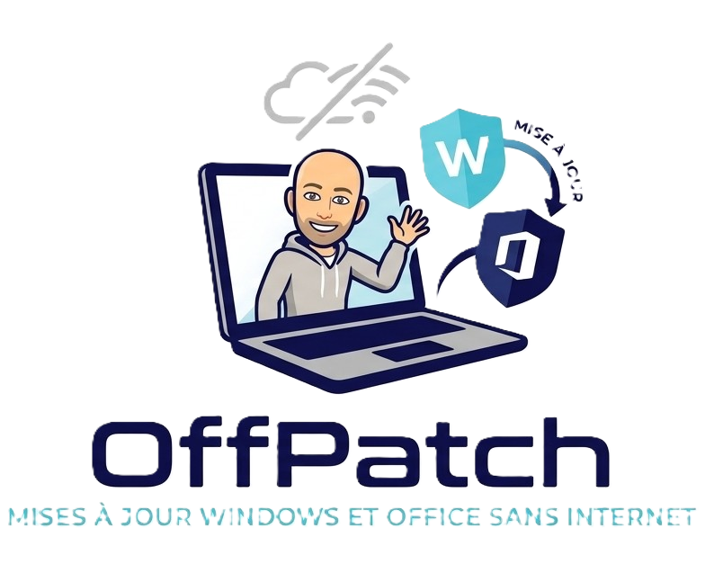

# OffPatch

Outil Windows portable qui prépare une fois par mois un dépôt de mises à jour Microsoft, puis les installe **sans connexion Internet** sur des PC traités un par un : en atelier, ou chez un client. Il prend la suite de WSUS Offline Update, qui n'est plus maintenu.

> **État du projet : développement, phase 6 (interface graphique) sur 8.** Aucune version stable n'est publiée. La mise à jour du dépôt, l'installation (manuelle et automatique, avec reprise après redémarrage) et l'interface fonctionnent ; elles ont été validées sur des runners GitHub et sur des machines virtuelles, pas encore sur des PC clients réels en nombre. L'assistant de préparation d'un support (clé USB) n'existe pas encore : pour l'instant, on copie le dossier de l'outil à la main.

## Ce que fait OffPatch

**Côté dépôt** (PC connecté, une fois par mois) : il télécharge et vérifie

- les cumulatives Windows 11 (24H2, 25H2, 26H2, x64 et ARM64) et Windows 10 22H2 (x64, ESU), avec leurs prérequis (cumulatives « checkpoint », SSU) ;
- l'enablement package Windows 11 26H2 ;
- les cumulatives .NET Framework ;
- la plateforme et les définitions Microsoft Defender ;
- une source Office par canal (Current, Office LTSC 2024, Office LTSC 2021), par l'Office Deployment Tool, pour mettre à jour l'Office Click-to-Run déjà installé sur le PC.

Chaque fichier est contrôlé au téléchargement (signature Authenticode Microsoft, SHA-256) et rangé dans un dépôt dédoublonné, décrit par un manifeste.

**Côté client** (PC hors ligne, depuis une clé USB ou un disque) : il détecte ce qui manque, établit un plan avec les redémarrages nécessaires, revérifie l'intégrité des fichiers juste avant de s'en servir, installe, puis écrit un rapport d'intervention HTML. Deux façons de faire :

- en mode manuel, on coche les étapes à installer ;
- en mode automatique, un écran récapitulatif montre tout ce qui va être fait (étapes, Office, rappel du mode Avion, forçage pour un Windows 10 sans ESU). On valide une fois, et OffPatch enchaîne les étapes et les redémarrages. Après chaque redémarrage, il reprend tout seul à l'ouverture de session, même si la clé a changé de lettre.

## Utilisation

L'interface se lance par `Lancer-OffPatch.cmd`, qui demande les droits d'administrateur. Elle a trois onglets :

- **Ce PC** : relevé du système, contrôles préalables, plan des mises à jour, Office détecté, boutons « Installation automatique », « Installer la sélection », « Reprendre la session interrompue » et « Redémarrer maintenant » ;
- **Dépôt** : choix des versions de Windows et des sources Office à garder, vérification des nouveautés, mise à jour du dépôt (annulable), purge des fichiers qui ne servent plus ;
- **Journal** : journal en direct, filtre par niveau, accès aux dossiers des journaux et des rapports.

Routine prévue : une fois par mois, sur un PC connecté, onglet Dépôt, « Mettre à jour le dépôt ». Ensuite on copie le dossier complet de l'outil (avec `depot\`) sur la clé ou le disque, puis on lance `Lancer-OffPatch.cmd` sur chaque PC à mettre à jour. Les rapports sont écrits dans `rapports\` sur le support, avec une copie dans `C:\ProgramData\OffPatch\logs\`.

`app\OffPatch-Cli.ps1` fait la même chose sans interface (actions `DepotUpdate`, `Plan`, `InstallStep`, `Report`, `Auto`). Il sert au débogage et aux essais ; `-Action Plan` ne modifie rien sur le PC.

## Principes

- Windows PowerShell 5.1 seulement, rien à installer sur le PC client, x64 et ARM64.
- Téléchargements uniquement depuis des domaines Microsoft autorisés.
- Uniquement des mises à jour : OffPatch n'installe ni Windows ni Office, ne gère aucune clé de produit, ne touche à aucune activation et ne retire aucun produit.
- Les données qui changent avec Microsoft (titres du catalogue, product IDs, liens) vivent dans la configuration, pas dans le code.

## Installation depuis GitHub

Si vous téléchargez l'archive zip du dépôt, débloquez-la **avant** de l'extraire : clic droit sur le fichier zip, Propriétés, cocher « Débloquer », OK. Sinon Windows marque chaque fichier extrait comme provenant d'Internet et affiche un avertissement au lancement, avant même qu'OffPatch puisse retirer cette marque (il le fait à chaque démarrage de l'interface).

Rien d'autre à installer : Windows PowerShell 5.1, présent sur tout Windows 10 et 11, suffit.

## Documentation

- [Cahier des charges](docs/CAHIER-DES-CHARGES.md) : référence fonctionnelle et technique.
- [Points de recherche](docs/RECHERCHE.md) : chaque point vérifié, avec ses sources, ses essais et la décision prise.
- [Backlog et journal](docs/TODO.md) : avancement par phase.
- [Essais](docs/essais/) : procédures de test sur runners GitHub et sur intervention réelle.

## Tests

- `ci.yml` : PSScriptAnalyzer et Pester 5 sous Windows PowerShell 5.1, à chaque push, sans accès réseau (pages du catalogue enregistrées dans `tests/Fixtures`).
- `catalog-contract.yml` : chaque mercredi, vérifie que les pages actuelles du Microsoft Update Catalog sont toujours reconnues et que les liens de téléchargement du moment restent sur les domaines autorisés. Sur un dépôt public, GitHub désactive les workflows planifiés après 60 jours sans activité dans le dépôt : il faut alors réactiver `catalog-contract.yml` dans l'onglet Actions.
- Les essais qui modifient le système (DISM, Defender, Office) tournent uniquement sur des runners GitHub hébergés et jetables, en déclenchement manuel. Ce que les runners ne permettent pas (redémarrages, Windows 10, Windows 11 x64 client) est validé sur intervention réelle.

## Licence

© 2026 David Informaticien. Code et documentation sous licence [MIT](LICENSE).

Exception : les pages du Microsoft Update Catalog enregistrées dans `tests/Fixtures/catalog/` appartiennent à Microsoft. Elles servent uniquement aux tests automatisés et ne sont pas couvertes par la licence MIT.

OffPatch est un projet indépendant, non affilié à Microsoft. Windows, Office et Defender sont des marques de Microsoft.
